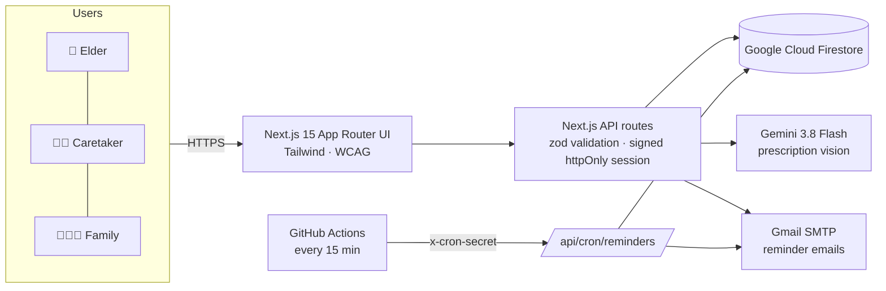

# CareCircle — Elderly Care & Medication Management Platform

> A shared care space where an elderly person, their caretaker and their family manage medicines, doctor visits and daily routines together. **The elder stays at the centre of every decision.**

**🔗 Live app:** https://carecircle-topaz.vercel.app  
**🩺 Health check:** https://carecircle-topaz.vercel.app/api/health

Built for **PromptWars × Catalyst** (Google for Developers × Hack2Skill). Challenge: *Elderly Care & Medication Management Platform*.

---

## 🚀 Try it in 10 seconds (judges)

Open the live app and click a card under **Judge Demo**. No sign-up needed.

| Role | Person | Passcode | What to try |
|---|---|---|---|
| 👵 Elder | Margaret Jenkins | `1234` | Big "Taken" buttons, **Read Medicines Aloud**, High Contrast, progress ring |
| 👩‍⚕️ Caretaker | Sarah Jenkins | `5678` | Add or edit medicines, **Gemini prescription scan**, appointments, run reminders |
| 👨‍👩‍👧 Family | David Jenkins | `9999` | 7-day adherence chart, activity audit trail, missed-dose escalations |

Circle ID: `CC-DEMO`. Demo data is seeded into Firestore automatically and refreshed every day.

---

## 📌 The problem

- Older adults often take **4–8 medicines a day** at different times, and missed or doubled doses are a leading cause of avoidable hospital visits.
- Families and caretakers **can't see** whether today's medicines were taken until something goes wrong.
- Most care apps treat the elder as a **passive subject**: others change their schedule without telling them.
- Copying handwritten prescriptions into an app by hand is slow and error-prone.

## 💡 The solution

A **Care Circle** per elder, joined with a **Circle ID + personal passcode**. The elder, caretakers and family members each have a role, and everyone sees the same live schedule.

| | What it does | Why it matters |
|---|---|---|
| 👵 **Elder-first design** | Large text, one-tap "Taken", high contrast, **voice read-aloud** of today's medicines | The person taking the medicine can use the app without help |
| 🔔 **"You're in control" notices** | When anyone changes the elder's schedule, the elder sees *who* changed *what* | The elder stays at the centre of their own care decisions |
| 📸 **Gemini prescription scan** | Photo of a prescription → **Gemini 3.8 Flash** extracts medicines, doses and times as JSON → a human reviews before saving | Removes manual typing errors; AI suggests, a person confirms |
| 🚨 **Two-step escalation** | A dose 0–30 min late reminds the **elder** first; still missed after 30 min, it alerts **caretaker and family** by email | Gentle for the elder, and family only gets alerted when it matters |
| 📊 **Adherence tracking** | Today's progress ring, adherence %, 7-day trend | Spot problems early |
| 📅 **Appointments** | Doctor visits with an email reminder 24 hours before | Visits aren't forgotten |
| 🧾 **Activity audit log** | Every change records who, what and when | Trust and accountability inside the family |
| 🌏 **Timezone-correct** | All schedules run in the elder's local time (default `Asia/Kolkata`) even though servers run in UTC | "8:00 AM" really means 8:00 AM for the elder |

---

## ☁️ Google services used

| Service | Used for |
|---|---|
| **Gemini 3.8 Flash** (`@google/genai`) | Multimodal prescription image → structured medication JSON (understands Indian `1-0-1` dosing notation; model is configurable with automatic fallback) |
| **Google Cloud Firestore** (`firebase-admin`) | All circles, members, medications, dose events, appointments and audit logs |
| **Firebase** (project + service account) | Secure server-side database access (production-mode rules: no direct client access) |
| **Gmail SMTP** (Nodemailer) | Dose, missed-dose escalation and appointment reminder emails |

---

## 🏗️ Architecture



- **Hosting:** Vercel serverless functions in `bom1` (Mumbai), next to the Firestore region. A `Dockerfile` (standalone output) is included for Google Cloud Run.
- **Scheduler:** GitHub Actions calls `/api/cron/reminders` every 15 minutes with a secret header.
- **Resilience:** every Firestore call has a timeout and falls back to an in-memory demo store, so the demo never crashes.

## 🧰 Tech stack

Next.js 15 (App Router, TypeScript) · React 19 · Tailwind CSS · Google Cloud Firestore · Gemini 3.8 Flash · Nodemailer · zod · bcryptjs · Vitest · GitHub Actions

---

## 🔒 Security

- Passcodes hashed with **bcrypt**; never stored or logged in plain text.
- Sessions are **HMAC-SHA256 signed, httpOnly, SameSite=Lax** cookies with expiry; tampered tokens are rejected (tested).
- Production refuses to run without a strong `SESSION_SECRET`.
- **Rate limiting** on login (5 attempts / 15 min).
- **Circle isolation:** every read and write checks that the record belongs to the signed-in member's circle.
- **zod** validation on every API input (time formats, dates, lengths, roles, statuses).
- Cron and seed endpoints need a secret header, compared with `timingSafeEqual`. The secret is never sent to the browser; the in-app "run reminders" button is authorised by the caretaker/family session instead.
- Firestore is in **production mode** (no public reads/writes); only the server, using a service account, can access data.
- Secrets live only in environment variables; `.env*` is git-ignored and `.env.example` documents them.
- Security headers via `next.config.ts` and `vercel.json`.

## ♿ Accessibility

- Elder Mode: large type, oversized tap targets, one primary action per card.
- **High-contrast mode** and full keyboard navigation with visible focus states.
- **Text-to-speech** of today's medicines (Web Speech API).
- Semantic landmarks, `aria-label`s on icon buttons, a live status line for screen readers, and a skip-to-content link.
- Respects `prefers-reduced-motion`.

## 🧪 Testing

```bash
npm test           # unit tests
npm run typecheck  # strict TypeScript
```

**48 unit tests** across 7 suites, run automatically on every push by the **CI workflow** (`.github/workflows/ci.yml`: type-check + tests) (Vitest):

| Suite | Covers |
|---|---|
| `adherence.test.ts` | Dose generation per day, date ranges, inactive medicines, adherence %, 7-day trend, escalation thresholds |
| `timezone.test.ts` | IST vs UTC day boundaries, 8:00 IST → 02:30 UTC, DST zones, month/year rollovers, deterministic dose IDs |
| `auth.test.ts` | Session signing, **tamper and role-escalation rejection**, expiry, bcrypt hashing, rate limiting |
| `validations.test.ts` | Invalid times and dates, limits, unknown roles, email requirements, dose statuses |
| `db.test.ts` | Demo seeding, hashed passcodes, batched writes, single-document reads, circle isolation |
| `email.test.ts` | Demo addresses never receive real mail; sending never throws |
| `gemini.test.ts` | Current model with automatic fallback, no raw API errors shown to users |

## 📈 Scalability

- Stateless serverless API; scales horizontally on Vercel or Cloud Run.
- **Few round-trips per request:** the dose endpoint makes 2 parallel reads, writes new doses in one **batched write**, and computes adherence over the last 7 days only. Dose updates use a **single-document read** for authorisation.
- The dashboard refreshes **only the data that changed** (a dose tap reloads doses and the audit log, not appointments or medicines).
- Firestore queries use **equality filters only** (sorting in code), so they need no composite indexes and scale with the data.
- **Deterministic dose IDs** (`dose-{med}-{date}-{time}`) make reconciliation idempotent: repeated or parallel requests never create duplicate doses.
- Seeding and reminders are idempotent and safe to retry.
- Emails time out after 8 s and never block a request; unconfigured Gmail falls back to logged "simulated" delivery.
- Next steps: Firestore batched reads for many circles, Cloud Tasks / Pub/Sub for fan-out reminders, FCM push notifications, SMS/WhatsApp for elders without email.

---

## ⚙️ Run locally

```bash
git clone https://github.com/pandirisiva234-pixel/carecircle.git
cd carecircle
npm install
cp .env.example .env.local   # fill in your values
npm run dev                  # http://localhost:3000
```

Without Firebase credentials, the app runs with the in-memory demo store, so it works out of the box.

### Environment variables

| Variable | Purpose |
|---|---|
| `SESSION_SECRET` | 32+ char secret for signing sessions |
| `CRON_SECRET` | Secret header for `/api/cron/reminders` and `/api/seed` |
| `GEMINI_API_KEY` | Google AI Studio key for prescription scanning |
| `FIREBASE_PROJECT_ID`, `FIREBASE_CLIENT_EMAIL`, `FIREBASE_PRIVATE_KEY` | Firestore service account |
| `GMAIL_USER`, `GMAIL_APP_PASSWORD` | Sending reminder emails |
| `APP_URL`, `NEXT_PUBLIC_APP_URL` | Public URL of the app |
| `APP_TIMEZONE` | Schedule timezone (default `Asia/Kolkata`) |

### Deploy

1. Import the repo in **Vercel** and paste the environment variables.
2. In GitHub → Settings → Secrets → Actions, add `APP_URL` and `CRON_SECRET` to enable the 15-minute reminder workflow.
3. (Optional) Deploy the same image to **Google Cloud Run** with the included `Dockerfile`.

## 🗂️ Project structure

```
app/
  page.tsx                 Landing page + judge demo login
  dashboard/page.tsx       Elder / caretaker / family dashboard
  api/
    auth/                  create-circle, join-circle, login, demo-login, me, logout
    medications/ doses/    Medication CRUD + daily dose tracking
    appointments/          Appointment CRUD
    prescription/scan/     Gemini prescription extraction
    cron/reminders/        Reminder + escalation engine (GitHub Actions)
    seed/ health/          Demo seeding, status check
components/                DoseCard, TodayProgress, AdherenceChart, PrescriptionScanner, ...
  landing/                 Data-driven landing sections (stats, features, steps, demo logins)
lib/
  db.ts                    Firestore data layer (timeouts + in-memory fallback + seeding)
  adherence.ts             Scheduling, adherence and escalation logic (pure, tested)
  timezone.ts              Timezone-safe date helpers (pure, tested)
  auth.ts                  Sessions, bcrypt, rate limiting
  gemini.ts  email.ts      Google AI + email integrations
  validations.ts           zod schemas
tests/                     Vitest suites
.github/workflows/         CI (type-check + tests) and 15-minute reminders
```

## 🔌 API overview

| Method | Route | Auth |
|---|---|---|
| POST | `/api/auth/demo-login`, `/api/auth/login`, `/api/auth/create-circle`, `/api/auth/join-circle` | Public (rate-limited) |
| GET/POST | `/api/medications`, `/api/doses`, `/api/appointments` | Session |
| PUT/DELETE | `/api/medications/[id]`, `/api/appointments/[id]` | Session, own circle only |
| POST | `/api/prescription/scan` | Session |
| GET | `/api/activity` | Session |
| POST | `/api/cron/reminders` | `x-cron-secret` or caretaker/family session |
| POST | `/api/seed` | `x-cron-secret` |
| GET | `/api/health` | Public (no secrets) |

---

Built by **Pandiri Sivaramakrishna** · MCA (AI & ML), Chanakya University
